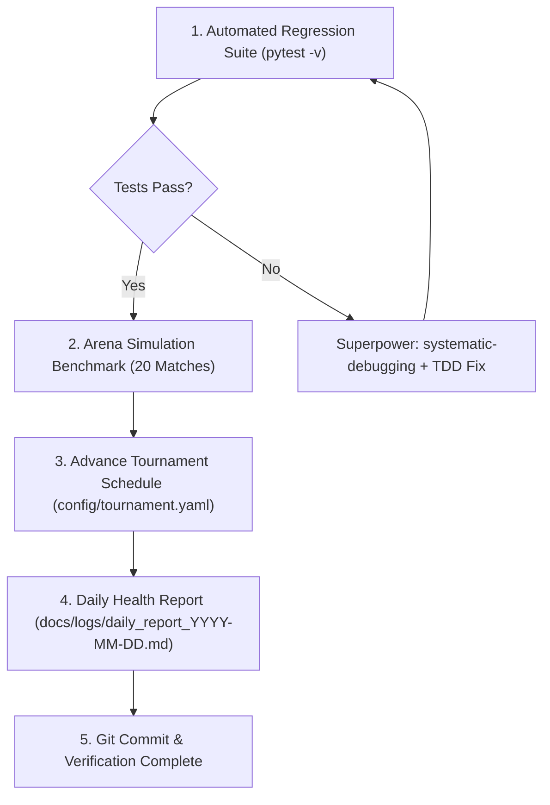

# Autonomous Daily Maintainer

## Overview
Synthesizes the complete Superpowers lifecycle (`using-superpowers`, `writing-plans`, `subagent-driven-development`, `systematic-debugging`, `verification-before-completion`) into an autonomous, non-interactive recurring maintenance workflow for the Battlecode RPS platform.

## When to Use
- Triggered by daily background cron schedules (`schedule` tool)
- When unattended health auditing, regression verification, or bot balance benchmarking is needed
- When rotating the daily Elo multiplier $x$ or advancing tournament calendar days

## The Superpowers Autonomous Lifecycle



### Step 1: Automated Regression Suite
Run full test suite in quiet/verbose mode:
```bash
pytest -v
```
If any test fails:
1. Immediately invoke `superpowers:systematic-debugging` to isolate root cause.
2. Use `superpowers:test-driven-development` to author minimal failing reproduction and patch.
3. Verify test suite returns to 100% green before proceeding.

### Step 2: Bot Balance & Tactical Benchmarking
Run 20 automated head-to-head matches between baseline bots to record statistical distributions:
```bash
python starter_kit/local_arena.py starter_kit/bot_template.py starter_kit/heuristic_bot.py --rounds 10 --max-turns 150
```
Log win ratios, average match length, goal reaches vs wipeout captures.

### Step 3: Tournament State Maintenance
1. Check `config/tournament.yaml`.
2. Randomize daily Elo multiplier $x \in [1.2, 2.5]$ for the upcoming active match window.
3. If current day exceeds $n$, prepare bracket seeding candidates.

### Step 4: Daily Log Generation
Write summary log to `docs/logs/daily_report_<YYYY-MM-DD>.md` capturing:
- Test suite pass rate (167/167)
- Bot arena win rate distribution
- Database match count & active participant count
- Daily multiplier $x$ configured

### Step 5: Git Ledger
Commit maintenance log:
```bash
git add docs/logs/ && git commit -m "chore(daily): autonomous maintenance and health check <date>"
```
