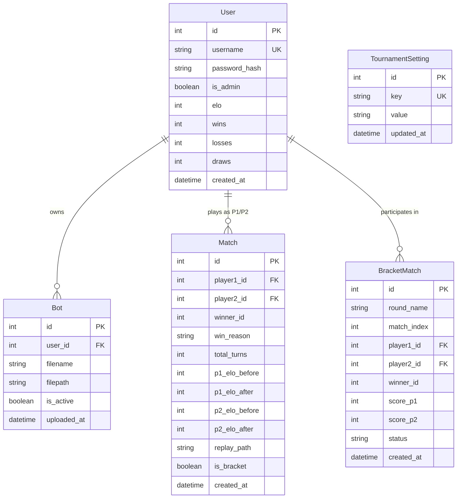

# 🏗️ Battlecode RPS 9×9 Platform — Technical Architecture Specification

> **Audience**: Technical evaluators, core developers, system maintainers.  
> **Source of Truth**: [`docs/CONTEXT_RESUME.md`](CONTEXT_RESUME.md)

---

## 1. System Overview & Philosophy

The Battlecode RPS 9×9 Platform is an autonomous tournament engine for 1v1 algorithmic bot duels, modeled after MIT Battlecode. The system is designed with four guiding principles:

1. **Zero-Node.js & Local-First**: The backend is pure Python (FastAPI + SQLAlchemy + SQLite WAL), and the frontend is pure HTML5/CSS3/Vanilla JS. No Node.js runtime, npm dependencies, or external asset pipelines are required.
2. **Centralized Safe Execution**: Bot code runs server-side in isolated worker subprocesses with strict 1.0s CPU timeouts and AST security checks. Competitor code is completely hidden from opponents.
3. **Multi-Machine Ready**: The platform automatically discovers its Local Area Network (LAN) IP, binding to `0.0.0.0:8000` to support multi-client LAN competitions out of the box.
4. **Single-Admin Security**: Only one administrator account exists in the system, governed by environment variables and enforced by seeder invariants and registration guards.

---

## 2. Multi-Tier System Architecture

```mermaid
graph TB
    subgraph Client Tier
        Browser["Web Browser (Vanilla JS Visualizer, Leaderboard, Admin)"]
        CLI["Local Arena CLI (Offline Testing)"]
    end

    subgraph Server Tier (FastAPI)
        Router["FastAPI Application Router (/api & Web Templates)"]
        Auth["Auth & Session Manager (Single-Admin Guard)"]
        MatchQueue["Background Match Worker (Asynchronous Task Queue)"]
    end

    subgraph Engine Tier (Isolated Subprocess)
        Sandbox["AST Security Validator (engine/sandbox.py)"]
        Runner["Subprocess Match Runner (engine/runner.py, 1.0s timeout)"]
        Game["Core 9x9 RPS Game Engine (engine/game.py)"]
    end

    subgraph Persistence Tier (SQLite WAL)
        DB[("SQLite Database: app.db (WAL Mode)")]
        Replays[("JSON Replay Logs: replays/match_<id>.json")]
        BotStorage[("Bot Files: bots/<user_id>_<filename>.py")]
    end

    Browser -->|HTTP / Cookies| Router
    Router --> Auth
    Router --> MatchQueue
    MatchQueue --> Sandbox
    MatchQueue --> Runner
    Runner --> Game
    Router --> DB
    MatchQueue --> DB
    MatchQueue --> Replays
    Router --> BotStorage
    CLI --> Game
```

---

## 3. Core Engine Components

### 3.1 9×9 Rock-Paper-Scissors Chess Engine (`engine/game.py`)
- **Coordinate Matrix**: 9×9 grid (`row: 0..8`, `col: 0..8`), where:
  - Row 0 corresponds to rank 1 (Player 1 starting row).
  - Row 8 corresponds to rank 9 (Player 2 starting row).
  - Col 0 to 8 map to files `a` through `i`.
- **Combat Hierarchy**:
  $$\text{Rock ('R')} \succ \text{Scissors ('S')} \succ \text{Paper ('P')} \succ \text{Rock ('R')}$$
  - Identical pieces block each other.
  - A piece cannot step into an enemy piece that beats it.
- **Victory Conditions**:
  1. **Goal Reach**: Player 1 piece reaches `i9` (`row=8, col=8`), or Player 2 piece reaches `a1` (`row=0, col=0`).
  2. **Wipeout**: Complete elimination of any single piece type (all 3 Rocks, all 3 Papers, or all 3 Scissors) of the opponent.
  3. **Turn Limit (200 Turns)**: The player with the highest total surviving piece count wins. In case of an exact tie, the match is a Draw.

### 3.2 AST Static Security Validator (`engine/sandbox.py`)
Uploaded Python bot files are analyzed prior to filesystem storage and execution. The validator inspects the Abstract Syntax Tree (AST) against 74 attack patterns:
- **Forbidden Imports**: Blocks `os`, `sys`, `subprocess`, `socket`, `shutil`, `ctypes`, `threading`, `multiprocessing`, `requests`, `urllib`, `builtins`, `importlib`.
- **Whitelisted Modules**: Allows safe standard modules: `math`, `random`, `copy`, `collections`, `heapq`, `itertools`, `typing`, `dataclasses`, `engine.game`.
- **Dangerous Built-ins**: Prohibits `open`, `eval`, `exec`, `compile`, `__import__`, `globals`, `locals`.
- **Dunder Escape Traps**: Disallows reflection via `__subclasses__`, `__builtins__`, `__globals__`, `__code__`, `__bases__`.
- **Entrypoint Enforcement**: Rejects code without a top-level `def get_move(board, my_player, history)`.

### 3.3 Isolated Subprocess Match Runner (`engine/runner.py`)
- Executes matches in a standalone Python child process.
- Each turn call to `get_move(...)` is guarded by a strict **1.0-second timeout**.
- Any bot that times out, raises an unhandled exception, or returns an invalid move instantly forfeits:
  - `win_reason = 'timeout'`
  - `win_reason = 'error'`
  - `win_reason = 'invalid_move'`
- Produces standardized JSON replays containing move-by-move algebraic notations (`SAN`) and timestamps.

---

## 4. Persistence & Database Design (`server/models.py`)

The platform utilizes SQLite configured with Write-Ahead Logging (`PRAGMA journal_mode=WAL; PRAGMA synchronous=NORMAL;`) to enable high-concurrency non-blocking reads during background match writes.



---

## 5. Tournament & Rating Mathematics (`server/tournament.py`)

### 5.1 Dynamic Daily Elo Formula
During FFA tournament days $1 \dots n$, each day features a random multiplier $x \in [1.0, 3.0]$:
$$E_A = \frac{1}{1 + 10^{(R_B - R_A)/400}}, \quad E_B = \frac{1}{1 + 10^{(R_A - R_B)/400}}$$
$$\Delta R_A = \text{round}\Big(x \times K \times (S_A - E_A)\Big), \quad K = 32$$
$$\Delta R_B = \text{round}\Big(x \times K \times ((1 - S_A) - E_B)\Big)$$
- Elo ratings are strictly clamped above zero: $R_{new} = \max(0, R_{old} + \Delta R)$.

### 5.2 Composite Final Tournament Score (Day $n+1$)
On the final day, Top 8 or Top 16 bots contest a Single Elimination BO3 Bracket. Final ranking balances cumulative Elo and playoff performance:
$$\text{Score}_{final} = w_{elo} \cdot \text{RankPoints}_{elo} + w_{bracket} \cdot \text{BracketPoints}$$

---

## 6. Multi-Machine Network Topology

```text
       [ Host Server Machine ]
   http://0.0.0.0:8000 (Local IP: 192.168.1.15)
              │
       ┌──────┴──────────────────────────┐
       │ Local Area Network (Wi-Fi/LAN)  │
       │                                 │
       ▼                                 ▼
[ Student Laptop 1 ]             [ Student Laptop 2 ]
http://192.168.1.15:8000        http://192.168.1.15:8000
Uploads bot & challenges        Uploads bot & watches replay
```

- When the host runs `python main.py`, `get_lan_ip()` identifies the active LAN IP and prints the link to share.
- Inbound traffic on port 8000 reaches the FastAPI router without requiring external cloud accounts or third-party proxies.
